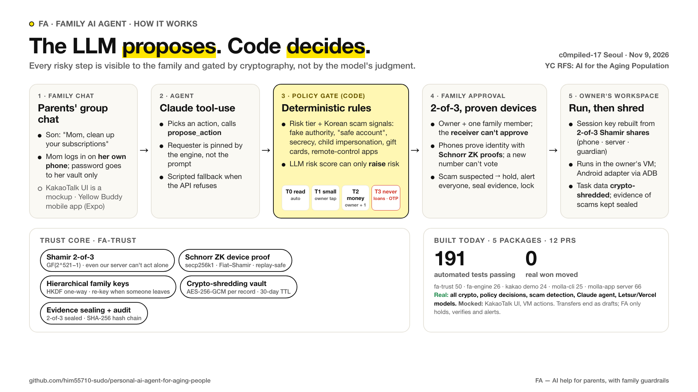

# Molla — 부모님을 위한 가족 AI 도우미

부모님이 이미 쓰는 단톡방에 들어가 사는 AI 도우미예요. 자식이 멀리서도 부모님 일을 대신 처리해 드릴 수 있고, 돈이 오가는 일은 가족이 함께 승인해야만 진행돼요. 휴대폰 앱(React Native)과 명령줄 도구(CLI)를 따로 실행할 수 있어요.

**한 줄로 말하면:** AI는 "이렇게 할까요?" 하고 제안만 하고, 실제로 할지는 미리 정해 둔 규칙(코드)이 정해요. 그래서 AI가 속아도 돈이 나가지 않아요.

## 모바일 앱 (Yellow Buddy)

흰색·노랑·검정의 대화 중심 화면이에요. iPhone과 Android에서 도는 진짜 앱(Expo)이고, 웹 페이지를 앱처럼 감싼 게 아니에요.

- [설치와 실행](molla-app/apps/mobile/README.md)
- [디자인 규칙](molla-app/DESIGN.md)
- [화면을 어디까지 확인했나](molla-app/docs/design/VERIFICATION.md)
- [서버와 주고받는 약속](molla-app/docs/live-api-handoff.md)

```sh
cd molla-app/apps/mobile
pnpm install --frozen-lockfile
pnpm start
```

앱이 쓰는 서버는 `molla-app/server`에 있어요. 로그인, AI(Letsur 또는 Vercel) 연결, 사람별 기억·허락·승인, Android 폰에서 앱을 여는 기능이 들어 있어요. [서버 설치·실행](molla-app/README.md)과 [지금 확인된 범위](molla-app/docs/STATUS.md)를 보세요. AI 열쇠(API 키), 개인 접속 코드, 실행 기록 저장소는 각자 환경에서 넣어요.

실제 Letsur·Vercel 모델이 한국어로 답하고 할 일 초안을 만드는 것까지 확인했어요. 클라우드에 있는 엄마용 Android 폰 한 대에서 "설정 앱 열어 줘"를 AI가 계획하고, 엄마가 승인하고, 설정 앱이 열리고, 그 화면이 앱에 보이고, 폰을 끄는 것까지 확인했어요. 앱 설치 파일(APK/IPA) 만들기와 실제 개인 휴대폰을 움직이는 건 확인하지 않았어요. [Android 확인 기록](molla-app/docs/live/MOBILE-VERIFICATION.md)

## 명령줄 도구 (Molla CLI)

**웹 서버도, 브라우저도 없이 터미널에서 바로 도는 도구예요.** AI 에이전트가 사람 대신 명령을 내릴 때 쓰는 규칙(라우팅 스킬)도 같이 있어요.

- [실행법](molla-cli/README.md)
- [에이전트용 규칙 SKILL.md](molla-cli/skills/molla-router/SKILL.md)
- [담당자에게 넘길 때 읽는 글](molla-cli/docs/HANDOFF.md)
- [명령 목록](molla-cli/docs/capabilities.json)

Node.js 24 이상이면 돼요. 따로 설치할 패키지도, 웹 앱도 필요 없어요.

[FA 엔진](fa-engine/README.md)은 카카오톡형 단톡방 데모가 쓰는 서버예요(가족 규칙 판단 + Claude 에이전트). Molla CLI v0.2는 서버 없이 혼자 돌아가서 FA 엔진이 없어도 돼요 (엔진을 띄우려면 `cd fa-engine && npm install && npm start`).

```sh
node molla-cli/bin/molla.mjs capabilities
node molla-cli/bin/molla.mjs health
```

v0.2는 내 컴퓨터의 작은 데이터베이스(SQLite)에 기록하고, 규칙 판단과 실행을 직접 해요. 승인은 "내가 본 내용이 맞는지"를 한 번에 비교해서 중간에 바뀌지 않게 하고, 승인한 뒤에 `task execute`를 따로 불러야 실제로 움직여요. 테스트 15개 중에는 "인터넷 없이도 혼자 도는지" 확인하는 것도 있어요.

지금 기본 실행은 할 일의 **초안**을 만드는 데서 끝나요. 진짜 클라우드 Android 폰을 쓰려면 운영자가 사람마다 폰 연결(ADB)을 준비해야 하고, 실제 로그인·폰 만들기·자동 결제와 송금은 들어 있지 않아요.

## 치즈 (FA) 카카오톡 데모


**치즈**는 가족이 점심으로 함께 먹은 크라이치즈버거에서 이름을 딴, 다정하고 꼼꼼한 우리 가족 AI 도우미예요.

[카카오톡 목업](fa-kakao-demo/README.md)에서 이런 흐름을 보여줘요: 누구 계정의 일인지 가리기, 엄마가 아들에게 "내 구독 목록 봐도 돼"라고 허락하기, 해지는 계정 주인이 직접 승인하기. 송금 승인, 보이스피싱 보류, 긴급 잠금 같은 보안 장면은 [fa-trust 보안 코어](fa-trust/README.md)가 판단하고, 채팅방에서 치즈를 누르면 열리는 **신뢰 패널**에 기록이 보여요. 구독 보기·해지 판단에는 [FA 엔진의 규칙 모듈](fa-engine/src/policy.js)도 같이 쓰여요. fa-trust 없이 실행하면(`FA_TRUST=off`) 송금은 FA 엔진의 규칙으로 처리돼요: 계정 주인 + 가족 1명이 승인해야 하고, 요청한 사람과 돈 받는 사람은 승인할 수 없어요.

## 어떻게 만들었고, 왜 믿을 수 있나

**AI는 할 일을 제안하고, 규칙 코드가 "해도 되는지"와 "누가 승인해야 하는지"를 정해요.** 아들이 "엄마 구독 정리해줘"라고 하면 서버는 요청한 사람을 아들로 기록하고, 엄마의 전용 공간과 "아들이 봐도 되는지" 허락을 확인해요. 해지는 엄마가 그 건을 직접 승인해야 진행돼요. [규칙 모듈](fa-engine/src/policy.js) · [카카오톡 라우터](fa-kakao-demo/router.mjs)

| 구성 | 무엇으로 만들었고 무슨 일을 하나 |
| --- | --- |
| 카카오톡 목업 | Node.js 서버와 브라우저 JavaScript로 가족방, 허락 카드, 신뢰 패널을 보여줘요. 구독 요청은 자체 규칙으로 알아듣고, 일반 대화는 원하면 OpenAI 호환 AI 모델을 붙일 수 있어요. [카카오톡 데모](fa-kakao-demo/README.md) |
| FA 엔진 | 별도 Node.js 서버예요. Claude가 고른 할 일을 정해진 모양으로 받아 규칙 모듈에 넘겨요. 요청한 사람은 서버가 정하고 AI가 바꿀 수 없어요. AI 설정이 없거나 AI 호출이 실패하면 규칙 기반 답으로 넘어가요. 카카오톡 목업은 이 엔진의 규칙 모듈을 가져다 써요. [FA 엔진](fa-engine/README.md) · [Claude 도구 호출](fa-engine/src/agent.js) |
| 신뢰 코어 (fa-trust) | TypeScript로 만든 보안 심장이에요. 위험 등급, 한국형 사기 신호, 등록된 폰 확인, 열쇠 나누기, 증거 보관을 담당해요. 카카오톡 목업의 송금 장면에 연결돼요. [fa-trust](fa-trust/README.md) |
| Yellow Buddy | Expo·React Native 휴대폰 앱과 로그인이 있는 Node.js 서버예요. Letsur 또는 Vercel AI Gateway로 한국어 대화와 할 일 초안을 만들고, 주인에게 연결된 Android 폰에서 앱을 열고 화면을 찍어 보여줘요. [모바일 앱](molla-app/README.md) · [확인된 범위](molla-app/docs/STATUS.md) |
| Molla CLI | Node.js 24 이상과 SQLite로 도는 별도 명령줄 도구예요. 버전이 적힌 JSON 요청을 받아 허용 목록에 있는 일인지 확인하고, 승인 뒤에 실행 명령을 따로 받아요. [CLI](molla-cli/README.md) · [에이전트용 규칙](molla-cli/skills/molla-router/SKILL.md) |

### 일의 위험도에 따라 승인이 달라져요

| 등급 | 규칙 |
| --- | --- |
| T0 · 보기만 | 계정 주인, 또는 주인이 "봐도 돼"라고 허락한 가족이 볼 수 있어요. |
| T1 · 연결·작은 일 | 계정 연결은 주인이 직접 해요. `fa-trust`에서 본인 확인을 마친 주인의 주문은 기본 5만 원 이하면 추가 승인 없이 진행할 수 있어요. |
| T2 · 송금·구독 해지 등 | 주인 승인이 기본이에요. `fa-trust`는 다른 사람이 요청했거나, 처음 보내는 곳이거나, 100만 원 이상이면 가족 한 명의 확인을 더 받아요. 돈을 받는 가족은 같이 승인할 수 없고, 처음 보내는 곳으로의 송금은 기본 3시간 기다렸다가 보내요. |
| T3 · 금지 | 대출, 계좌 만들기, 상품권 구매, 인증번호(OTP) 알려주기, 원격조종 앱 설치는 누가 승인해도 실행하지 않아요. |

"검찰·경찰이에요", "자녀예요(새 번호)", "안전계좌로 옮기세요", "가족한테 말하지 마세요" 같은 말은 보이스피싱 신호로 봐요. 기준을 넘으면 일을 기본 24시간 멈추고, 가족에게 알리고, 증거를 잠가서 보관해요. 가족이 "사기예요"라고 신고하거나 같은 요청에 가짜 승인이 되풀이되면 긴급 잠금이 걸려요. AI가 매긴 위험 점수는 신호를 **더할 수만** 있고, 최종 승인 조건은 규칙이 집행해요. [위험 판단 코드](fa-trust/src/policy.ts) · [보류와 잠금](fa-trust/src/trust.ts)

### 열쇠와 증거는 이렇게 지켜요

| 기술 | 쉽게 말하면 |
| --- | --- |
| Shamir 2-of-3 | 계정을 여는 열쇠를 세 조각으로 나눠 주인 폰·서버·보호자 폰이 하나씩 가져요. 두 조각이 모여야 열리고, 한 조각만으로는 아무것도 알 수 없어요. 아주 큰 소수(2⁵²¹−1) 위에서 계산해요. 이 "조각 수"는 "승인하는 가족 수"와는 별개예요. [열쇠 나누기](fa-trust/src/shamir.ts) |
| Schnorr 영지식 기기 증명 | 등록된 폰이 "나 진짜 그 폰이야"를 비밀은 보내지 않고 증명해요(secp256k1, Fiat–Shamir). 증명은 가족·사람·작업에 묶여 있어서 한 번 쓴 승인을 다른 데 다시 쓸 수 없어요. [기기 증명](fa-trust/src/zk.ts) |
| HKDF-SHA256 가족 열쇠 | 가족 한 명을 내보내거나 긴급 잠금을 걸면 가족 열쇠를 새로 만들고 함께 쓰던 기억을 다시 잠가요. 나간 사람은 그 뒤 기록을 못 봐요. [가족 열쇠](fa-trust/src/gkm.ts) · [가족 관리](fa-trust/src/trust.ts) |
| AES-256-GCM 금고 | 기록마다 다른 열쇠로 잠가요. 작업이 끝나거나 기한(기본 30일)이 지나면 그 열쇠를 지워서 아무도 못 읽게 해요. [금고](fa-trust/src/vault.ts) · [연결·작업 수명](fa-trust/src/trust.ts) |
| 증거 보관과 기록 사슬 | 사기 시도의 증거는 작업 기록과 다른 열쇠로 잠그고, 가족 폰 두 대의 조각이 있어야 열려요. 보안 기록은 SHA-256으로 사슬처럼 엮어서 중간에 고치면 티가 나요. [증거 보관](fa-trust/src/evidence.ts) · [기록 사슬](fa-trust/src/audit.ts) |

### 진짜로 되는 것과 보여주기용인 것

규칙·암호 코드와 테스트는 저장소에 있고, Letsur와 Vercel이 실제로 한국어로 답하고 할 일 초안을 만든 기록도 있어요. 카카오톡 화면, 가족 역할, 구독 전용 공간은 연습용 샘플이고, 송금은 초안이나 연습용 영수증에서 끝나요. 모바일 쪽에서는 클라우드 Android 폰 한 대에서 설정 앱 열기, 실제 화면 찍기, 폰 끄기를 확인했어요. [카카오톡 데모 범위](fa-kakao-demo/README.md#llm-설정과-데모-범위) · [모바일 확인 상태](molla-app/docs/STATUS.md)

<details>
<summary>발표 자료: 기술 흐름 그림과 쉬운 보안 설명</summary>




중학생 눈높이로 쓴 글 버전은 [docs/submission/SECURITY_EASY.md](docs/submission/SECURITY_EASY.md), 그림판은 [security-easy.png](docs/submission/slide/security-easy.png)에 있어요. 위 그림은 2026-11-09 발표용 요약이고, 정확한 승인 조건과 구현 범위는 이 README의 표가 기준이에요.

</details>
