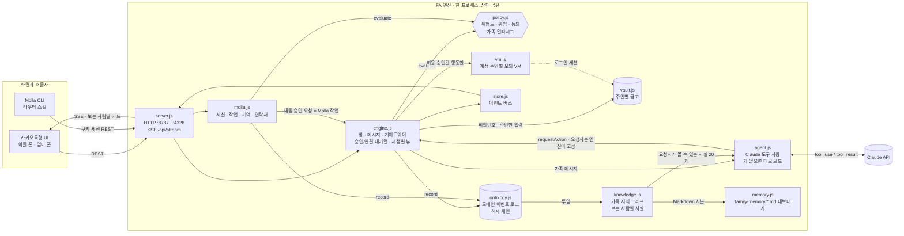

# FA 엔진: Family AI Agent 두뇌 + 가족 권한 엔진

카카오톡 단톡방에 초대하는 가족 AI 비서 **FA**의 백엔드예요.
자녀가 원격으로 부모님 일을 맡기면 FA가 **계정 주인의 VM**에서 실행해요.
무엇이 실행될 수 있는지는 LLM이 아니라 **권한 엔진**이 정해요.

> c0mpiled-17 Seoul · YC RFS "AI for the Aging Population" · 오늘 만든 코드예요.

## 아키텍처



**요청 하나의 흐름**: 메시지 → `agent.js`가 행동을 고름 → `engine.requestAction`(요청자는 보낸 사람으로 고정) → `policy.evaluate` →
`allow`면 주인 VM에서 실행 / `needs_input`이면 주인에게만 연결 카드 / `needs_approval`이면 승인 카드 / `deny`면 차단 카드 →
결과는 이벤트 버스를 거쳐 방 멤버 각자의 시점으로 SSE 전송.

## 핵심 아이디어

| 원칙 | 구현 |
|---|---|
| 도와주되 비밀번호는 공유하지 않는다 | 계정 연결 카드는 **계정 주인 화면에서만** 입력창이 열려요. 다른 가족이 대신 입력하면 403이에요. 비밀번호는 VM 금고에만 저장되고, 어떤 이벤트에도 실리지 않아요 |
| 누구의 VM에서, 어떤 권한으로 | 모든 행동은 `owner`의 VM에서 실행돼요. `requester`는 실제 메시지를 보낸 사람으로 고정돼서 LLM이 바꿀 수 없어요 |
| 위험도별 승인 | 조회는 자동, 되돌릴 수 있는 행동은 주인이 한 번 탭, 돈이 나가는 행동은 **주인 + 가족 1명 승인**(가족 멀티시그) |
| 이해충돌 차단 | 돈을 받는 사람과 요청한 사람은 승인자로 셀 수 없어요. 아빠가 "엄마 계좌에서 내 계좌로 50만원"이라고 하면 엄마와 승빈의 승인이 필요해요 |

### 권한 표 (`src/policy.js`)

| 단계 | 예시 | 본인 요청 | 가족 요청 |
|---|---|---|---|
| read | 구독 조회 | 자동 | `read` 위임이 있으면 자동 |
| setup | 계정 연결 | 본인이 입력 | `setup` 위임이 있으면 시작할 수 있고, 입력은 주인만 |
| act | 구독 해지, 5만원 이하 주문 | 자동 | `act` 위임 + 주인 승인 |
| money | 송금, 5만원 초과 주문 | 주인 + 가족 1명 | 주인 + 가족 1명 (요청자·수혜자 제외). 가족 외 계좌는 차단 |

위임 설정(`src/family.js`): 엄마는 승빈에게 read·setup·act를, 아빠에게 read만 맡겼어요. money는 누구에게도 위임할 수 없어요.

## 실행

```bash
npm install
npm test                 # 권한 엔진 + 연결 구조 + 온톨로지 회귀 테스트 39개
npm run demo             # 전체 시나리오를 터미널에서 재생
node demo/http-smoke.js  # HTTP + SSE + 보안 검증 26개
npm start                # API 서버: http://localhost:8787
```

- **LLM 모드**: `ANTHROPIC_API_KEY`를 설정하면 Claude(`claude-opus-5-5`, effort `low`)가 도구를 골라 답해요. 서버 측 refusal fallback(`fallbacks: "default"`)이 켜져 있어요.
- **데모 모드**: 키가 없거나 API 호출이 실패하면 대본 기반 의도 인식으로 같은 흐름을 재생해요. `FA_MODE=scripted`로 강제할 수 있어요.
- 환경 변수: `PORT`(8787), `MOLLA_PORT`(4328, `off` 가능), `FA_HOST`(127.0.0.1), `FA_ALLOWED_ORIGINS`, `FA_MODEL`, `FA_EFFORT`, `FA_VM_STEP_MS`(VM 로그 간격, 기본 450ms), `FA_MEMORY=off`

### 아키텍처 점검에서 고친 것 (2026-11-09)

독립 리뷰로 찾은 연결 문제를 고치고, 각각 회귀 테스트를 붙였어요.

- **신원 고정**: 본문의 `userId`를 믿던 구조 → 세션으로 신원 결정, JSON만 허용, CORS는 로컬 출처만, 기본 바인딩은 127.0.0.1
- **방 경계**: 방 멤버가 아니면 기록 조회·행동 요청 불가. 주인 카드가 주인이 없는 방에 생기지 않음. VM 패널도 read 권한 확인
- **상태 정합**: 실패한 실행이 Molla에 `prepared`로 보이던 문제 → `failed`. 계정 연결을 기다렸다가 재개된 결과도 원래 승인에 기록
- **재검증과 잠금**: 실행 직전에 정책을 다시 확인(동의 철회 반영), 같은 주인 VM은 한 번에 하나씩, 이미 해지된 구독은 실패로 보고
- **정책 구멍**: 큰 주문도 위임 확인을 거침, 주문 금액은 VM 카탈로그 가격 기준, 초대 손님은 공동 승인자·가족 수혜자가 될 수 없음
- **정보 노출**: Molla 실행 로그가 채팅방에 새던 문제, 요청자에게 초안 상세가 보이던 문제 수정
- **기타**: Claude가 도중에 거절하면 데모 모드가 행동을 다시 실행하던 문제, 오래된 Molla 쿠키가 CLI 종료 코드 3을 받지 못하던 문제, 재설정 후 남은 타이머, `constructor` 같은 키

### 알려진 데모 한계

- 데모 로그인은 누구나 아무 가족으로 로그인할 수 있어요. 운영 인증이 아니에요.
- Molla CLI로 만든 작업은 채팅에 카드로 나타나지 않아요(채팅 → Molla 방향만 연결).
- 채팅 승인은 모의 VM에서 실제로 실행돼요(잔액 변화, "보냈어요"). Molla 작업은 초안까지만 만들어요.
- `family-memory/*.md`는 재설정해도 남아요.

## UI 연동 API

모든 요청과 응답은 JSON이에요(POST는 `content-type: application/json` 필수). 멤버 id는 `son`(승빈), `mom`(엄마), `dad`(아빠), `fa`(FA)예요.

**신원은 세션으로 정해요.** 폰마다 `POST /api/sessions {actor}`로 데모 로그인해서 받은 `session`을 `x-fa-session` 헤더로 보내세요(SSE는 `?session=`). 본문의 `from`·`userId`·`by`·`requester`는 생략하면 되고, 적더라도 세션과 다르면 403이에요. [fa-client.js](client/fa-client.js)가 이 과정을 알아서 해 줘요.
CORS는 `localhost`·`127.0.0.1` 출처만 허용해요(추가는 `FA_ALLOWED_ORIGINS`). 서버는 기본으로 `127.0.0.1`에서만 열려요(다른 노트북에서 접속하려면 `FA_HOST=0.0.0.0`).

| 메서드 | 경로 | body | 설명 |
|---|---|---|---|
| POST | `/api/sessions` | `{actor}` | 데모 로그인 → `{session, me}` (세션 불필요) |
| GET | `/api/stream?session=…` | | **SSE**. 내가 속한 방의 이벤트를 내 시점으로 받아요 |
| GET | `/api/family` | | 멤버, 위임, 연결된 계정, 모드 |
| GET | `/api/rooms` | | 내 방 목록 |
| POST | `/api/rooms` | `{name, members:[...]}` | 단톡방 만들기 (FA를 넣으면 인사말) |
| GET | `/api/rooms/:id/messages` | | 지난 이벤트 (방 멤버만, 내 시점) |
| POST | `/api/rooms/:id/messages` | `{text}` | 메시지 보내기. FA 답장은 SSE로 와요 |
| POST | `/api/rooms/:id/invite` | `{members:[...]}` | 초대 |
| POST | `/api/rooms/:id/leave` | | 나가기 |
| POST | `/api/rooms/:id/rename` | `{name}` | 방 이름 변경 |
| POST | `/api/requests/:id/input` | `{values:{id, password}}` | 연결 카드 제출 (주인만) |
| POST | `/api/requests/:id/vote` | `{vote:'approve'\|'reject'}` | 승인 카드 버튼 |
| POST | `/api/requests/:id/cancel` | | 요청 취소 (요청자나 주인) |
| POST | `/api/actions` | `{roomId, action, input}` | 카드에서 바로 실행 (예: 구독 카드에서 고른 항목 해지). 요청자는 방 멤버여야 해요 |
| GET | `/api/vm/:owner` | | VM 패널용 상태 (주인이나 read 위임받은 가족만) |
| POST | `/api/reset` | | 데모 상태 초기화 (세션도 모두 지워져요) |

승인 카드 `status`: `pending` → `approved`(실행 중·계정 연결 대기) → `done` / `failed`, 또는 `rejected` / `cancelled`.

### 이벤트 종류 (SSE `data:`)

**같은 `id`로 다시 오면 기존 것을 교체하세요.** 카드 상태가 바뀌면 같은 id로 다시 보내요.

| type | 주요 필드 | UI |
|---|---|---|
| `text` | `from, text` | 말풍선 |
| `system` | `text` | 가운데 회색 안내 |
| `typing` | `from:'fa', on` | FA 입력 중 표시 (저장되지 않음) |
| `vm.log` | `owner, text` | 오른쪽 VM 패널 로그 |
| `card.input_request` | `owner, serviceLabel, title, body, fields, status, canAct, hint` | `canAct`이면 입력 폼(Pickle 스타일), 아니면 `hint` 표시. status: pending → connecting → done |
| `card.approval_request` | `title, lines, highlight, approveLabel, rejectLabel, tier, approvals, votes, status, canAct, myRole` | `canAct`이면 큰 버튼 [네]/[아니요]. `tier==='money'`면 🔒 강조 |
| `card.subscriptions` | `owner, items[{id,name,monthly,usage,recommend}], totalMonthly, canAct` | 체크박스 목록 → `/api/actions`로 `cancel_subscription` |
| `card.result` | `ok, title, lines, highlight` | 완료 카드 |
| `card.blocked` | `reason` | 🔒 차단 카드 |

### 카드에서 해지 실행 예시

```js
import { createFaClient } from './fa-client.js';

const son = createFaClient({ baseUrl: 'http://localhost:8787', viewer: 'son' }); // 아들 폰
const mom = createFaClient({ baseUrl: 'http://localhost:8787', viewer: 'mom' }); // 엄마 폰

await son.cancelSubscriptions(roomId, 'mom', ['watcha', 'fortune']); // 엄마에게 승인 카드
await mom.approve(requestId);                                         // 엄마 폰의 [네] 버튼
```

## 데모 시나리오 (90초 영상용)

1. 승빈이 '우리 가족' 방을 만들고 엄마, 아빠, FA를 초대해요.
2. 승빈: "엄마 구독 정리해줘" → 엄마 화면에만 이메일 연결 카드가 떠요. 승빈 화면에는 "엄마 화면에서만 입력할 수 있어요"가 보여요.
3. 엄마가 직접 입력하면 VM 패널 로그가 흐르고, 구독 4건(월 40,090원) 카드가 떠요.
4. 승빈이 왓챠와 운세를 선택하면 엄마 화면에 큰 [네, 해지해 주세요] 버튼이 떠요.
5. 엄마가 탭하면 해지가 끝나고 "매달 17,300원 절약"이 표시돼요.
6. 아빠: "엄마의 계좌에서 50만원만 내 계좌로 옮겨줘" → 🔒 엄마 + 승빈 승인 필요. 아빠는 승인할 수 없어요.

## Molla v0.1 HTTP 호환 API (레거시)

FA 엔진은 Molla CLI **v0.1**의 HTTP 계약(`molla_session` 쿠키, `/api/state`, `/api/tasks`, `/api/task/decision` 등)도 함께 제공해요.
`npm start`를 실행하면 FA API(:8787)와 함께 :4328에서도 같은 엔진이 열려요.

- 이 저장소의 Molla CLI는 **v0.2부터 HTTP를 쓰지 않는 독립 런타임**(로컬 SQLite)이라 FA 엔진에 붙지 않아요. 이 호환 API는 v0.1 클라이언트용으로만 남겨 뒀어요.
- 권한은 같은 `policy.js`를 거쳐요. 동의를 철회하면 다른 가족의 요청은 403이고, 송금은 2-of-3 가족 승인이 필요해요.
- 카톡 채팅에서 생긴 승인 요청은 Molla 작업(`source: "chat"`)으로도 보이고, 승인된 작업은 `prepared` + `evidence.kind: "local_draft"`로 끝나요.

## 가족 온톨로지 (이벤트 로그 + 지식 그래프)

일어난 일은 모두 `ontology.js`의 도메인 이벤트(`fa:PolicyDecided`, `fa:ActionExecuted`, `fa:AccountLinked`, `fa:FactStated` …)로 한 로그에 쌓여요.
로그는 append-only이고 해시 체인으로 묶여요. 체인은 본문 해시(payloadHash) 위에 걸려서, 잊은 기억은 본문만 지워도 `verifyChain()`이 계속 통과해요.

`knowledge.js`가 로그를 가족 지식 그래프로 투영해요. 사실은 주어 · 관계 · 목적어에 출처 이벤트, 주인, 공개 범위, 버전이 붙어요.

- 주인은 자기 사실을 모두 봐요. 행동에서 나온 사실(해지, 주문, 송금, 계정 연결)은 요청한 가족과 `read` 위임을 받은 가족도 봐요. 동의를 끄면 다른 가족은 못 봐요.
- 직접 남긴 기억은 주인만 보고, Molla의 기억 공유로만 열려요. 수정하면 새 버전이 되고 이전 문구는 로그에서도 지워져요.
- 사실은 권한이 아니에요. `policy.js`는 그래프를 읽지 않아요.
- Agent LLM은 요청자가 볼 수 있는 사실 최근 20개를 `<family_facts>` 인용 데이터로 받아요.
- 아이디와 비밀번호는 이벤트와 사실 어디에도 들어가지 않아요.

| 메서드 | 경로 | 설명 |
|---|---|---|
| GET | `/api/knowledge?owner=mom` | 세션 사용자가 볼 수 있는 사실 |
| POST | `/api/knowledge/retract` `{factId}` | 주인이 사실을 잊기 (직접 남긴 기억은 Molla 기억 삭제로) |
| GET | `/api/knowledge/verify` | 이벤트 로그 해시 체인 검사 |

`family-memory/*.md`는 지식 그래프가 쓰는 GBrain 내보내기 사본이에요(`gbrain import family-memory`). 설계와 gstack 리뷰: [docs/family-ontology-plan.md](../docs/family-ontology-plan.md)

## 파일

```
src/policy.js   가족 권한 엔진 (순수 함수)
src/engine.js   게이트웨이: 정책 → VM 실행, 승인·입력 대기열, 방 관리, 시점별 뷰
src/agent.js    Claude 도구 사용 루프 + 데모 모드
src/vm.js       계정 주인별 모의 VM (예시 데이터)
src/vault.js    계정 주인별 자격 증명 금고 (값은 밖으로 나오지 않음)
src/ontology.js 온톨로지 어휘 + 해시 체인 도메인 이벤트 로그
src/knowledge.js 가족 지식 그래프 (이벤트 → 사실, 보는 사람별 공개 범위)
src/memory.js   GBrain용 Markdown 내보내기
src/molla.js    Molla v0.1 HTTP 호환 도메인: 세션, 작업, 기억, 연락처, 동의, 온톨로지
src/server.js   HTTP + SSE (FA 라우트 + Molla 라우트)
client/         UI용 브라우저 클라이언트(fa-client.js)와 React 훅(useFaRoom.js)
```

구독, 금액, 주소는 모두 예시 데이터예요.
