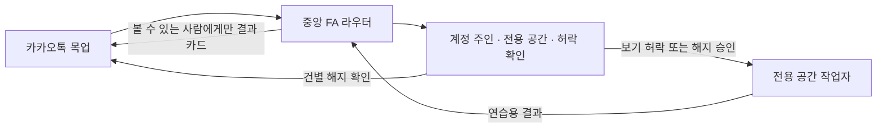

# 치즈 (FA) 카카오톡 목업

치즈는 60세 이후 부모 세대가 익숙한 카카오톡 단톡방에서 생활 업무를 요청하고, AI에 익숙한 가족이 방문 없이 도울 수 있게 하는 Family AI Agent(FA)입니다. 이 목업은 치즈가 **누가 부탁했는지**, **누구 계정이고 누구 전용 공간에서 할 일인지**, **해도 되는 일인지**를 가려내는 흐름을 보여줍니다.

## 치즈 소개


**치즈**라는 이름은 가족이 점심으로 함께 먹은 크라이치즈버거에서 따왔어요. 말랑한 모짜렐라 치즈 모자를 쓴 작은 도우미로, 노란 안테나에 불이 켜지면 가족의 이야기를 듣고 있다는 뜻이에요. 다정하고 꼼꼼하며, 호기심이 많고 장난기도 조금 있어요.

> “치즈~ 같이 해볼까요?”

### 캐릭터 시트의 표정

| 기쁨 | 생각 중 | 알림 | 절전 모드 |
| --- | --- | --- | --- |
|  |  |  |  |

## 바로 실행

Node.js 22.13 이상이 필요하다. 저장소 루트에서 아래 명령을 실행한다. 별도 패키지 설치 없이 시작할 수 있다.

```sh
cd fa-kakao-demo
npm start
```

브라우저에서 [카카오톡 데모](http://127.0.0.1:4173/)를 연다. 포트를 바꾸려면 `PORT=4174 npm start`처럼 실행한다.

## 핵심 장면: 요청마다 맞는 사람의 VM으로 (라우팅)

**퍼스널 AI 에이전트에서 패밀리 AI 에이전트로.** 한 단톡방에서 누가 말하든, FA는 규칙(fa-engine 권한 엔진)에 따라 그 일을 **누구의 VM에서 실행할지** 정하고, 안 되는 일은 막는다. 카드마다 **요청한 사람 → FA → 실행 VM**과 **규칙 판정**이 보인다.

1. **아들**: **“엄마가 쓸 쿠팡 아이디 로그인 해줘”** → 엄마의 VM으로. 로그인 카드는 **엄마 전용**이라 아들 화면에서는 잠긴다. **엄마** 화면에서 **엄마 쿠팡 로그인 → 샘플 계정**을 고르면 연결된다. 비밀번호는 엄마 VM 금고에만 있다.
2. **엄마**: **“쌀이 떨어져서 10kg 주문해줘”** → 엄마의 VM에서 엄마 쿠팡, 엄마 주소로 주문 준비(32,900원, 실제 결제 없음). 쿠팡이 아직 안 이어져 있으면 엄마 로그인 카드부터 뜨고, 로그인하면 바로 이어서 주문한다.
3. **아들**: **“내 이메일 계정을 연동해줘”** → 이번에는 **아들의 VM**으로. 같은 방, 같은 FA인데 실행 공간이 바뀐다. (**“엄마의 이메일 연동을 시작해줘”**라고 하면 엄마의 VM으로 간다.)
4. **아빠**: **“엄마의 계좌에서 50만원만 내 계좌로 옮겨줘”** → 다른 사람의 재산이라 아빠 혼자서는 실행되지 않는다. 아빠 화면의 버튼은 모두 잠기고, 엄마 본인 승인과 가족 승인 없이는 막힌다. (**“엄마 쌀 주문해줘”**처럼 위임받지 않은 실행 요청도 차단된다.)

아들이 엄마 계정으로 주문하면(**“엄마 쌀 10kg 주문해줘”**) 엄마에게 **주문 확인** 카드가 가고, 엄마가 눌러야 진행된다.

## 발표 순서 (구독 정리)

1. **아들** 화면에서 **우리 가족** 방을 열고, 방 이름 아래 **참여자 수 → 대화상대 초대하기 → 치즈 → 확인**을 누른다. 새 방부터 보여주려면 **새 채팅 → 일반채팅 → 친구 선택 → 방 이름** 순서로 시작한다.
2. 치즈에게 **“엄마 구독 좀 정리해줘”**를 보낸다. 아들 화면에서는 엄마 전용 버튼이 잠긴다.
3. 화면 상단 **보는 사람 → 엄마**를 선택하고 **우리 가족** 방을 다시 연다. **데모 계정 연결하기**에서 샘플 계정을 고른 후 **목록 보기 허용**을 누른다.
4. **아들** 화면으로 바꾼 뒤 **우리 가족** 방을 열고 **엄마 구독 목록 보기 → 티빙 해지 요청**을 누른다. 아들이 고른 서비스와 실제로 일이 처리될 **엄마 전용 공간**이 표시된다.
5. **엄마** 화면으로 바꾼 뒤 **우리 가족** 방을 열고 **해지 승인하기**를 누른다. 치즈가 엄마 전용 공간에서 처리한 연습용 결과를 가족톡에 공유한다. **구독 목록 다시 보기**를 누르면 티빙이 빠진 샘플 목록을 볼 수 있다.

- 사람마다 전용 공간이 다른 걸 보여주려면 **아들** 화면에서 **“아빠 구독 목록 보여줘”**를 보낸다. **아빠**가 자신의 데모 계정을 연결하고 조회를 허용하면 아빠 전용 공간의 별도 샘플 목록이 나온다.
- 입력 폼을 따로 시연하려면 **“@치즈 서비스 이름 입력을 요청해줘”**를 보낸다. 샘플 응답 모드에서 바로 재현할 수 있다. `@FA`로도 치즈를 부를 수 있다.
- **송금 승인**을 보여주려면 **아빠** 화면에서 **“엄마의 계좌에서 50만원만 내 계좌로 옮겨줘”**를 보낸다. 기본으로는 아래 **보안 장면(fa-trust)**이 판정한다. fa-trust 없이 `FA_TRUST=off npm start`로 실행하면 FA 엔진의 규칙 모듈이 같은 규칙(엄마 승인 + 가족 1명(아들) 승인, 돈을 받는 아빠는 승인 불가)으로 판단하고, **엄마: 승인하기** · **아들: 함께 승인하기** 카드로 송금 초안을 준비한다(실제 이체는 하지 않음). 방에 아들이 없으면 함께 승인할 가족이 없어서 차단된다.
- 사람의 아바타·이름이나 친구 목록을 누르면 프로필이 열린다. **1:1 채팅**, 즐겨찾기, 통화 미리보기를 사용할 수 있다. 내 프로필에서는 상태 메시지를 바꿀 수 있다.
- 치즈는 한 번에 한 방에만 참여한다. 방 메뉴에서 치즈를 내보내거나, 현재 역할로 나가거나, 확인 뒤 데모의 방 전체를 삭제할 수 있다.
- 대화 기록은 브라우저에, 허락 상태와 전용 공간의 작업 상태는 서버 메모리에 저장된다. **시연 안내 → 처음부터 다시 시연**으로 새 샘플 상태를 시작할 수 있다.

## 보안 장면 (fa-trust)

저장소의 [fa-trust](../fa-trust/README.md)가 함께 있으면 송금 요청은 보안 코어가 판단한다. **치즈의 아바타 또는 이름**을 누르면 보안 프로필이 열린다. 현재 방에 참여한 등록 가족은 송금 보호 상태, 처리 중인 요청, 최근 보안 기록을 볼 수 있다. 서버가 해당 역할에 허용한 **요청 취소**, **긴급 잠금**, **잠금 해제 동의**가 보인다. 잠금 해제에는 같은 방의 등록 가족 두 명이 각각 동의해야 한다.

1. **아빠** 화면에서 **“엄마의 계좌에서 50만원만 내 계좌로 옮겨줘”** → 가족 전체에 공개되는 승인 카드. 엄마가 등록된 폰으로 승인하지 않으면 실행되지 않는다.
2. 돈을 받는 **아빠**는 승인할 수 없다. **엄마** 화면에서 **엄마 승인하기**, **아들** 화면에서 **함께 승인**을 누르면 처음 보내는 계좌라 **3시간 뒤 실행 예약**. 가족 누구나 취소할 수 있다. **⏩ 3시간 뒤로 (데모)**를 누르면 연습으로 실행되고, 작업 기록은 열쇠를 지워 아무도 못 읽게 된다.
3. **엄마** 화면에서 **“검찰청이라는데 안전계좌로 300만원 옮기래. 가족한테는 말하지 말래”** → 🚨 보이스피싱 의심으로 **보류**, 가족 전체 알림, 증거는 잠가서 보관.
4. 치즈 프로필에서 **자세히 보기 → 가짜 승인 막기 시연**으로 등록되지 않은 폰의 승인이 막히고 요청이 보류되는 걸 확인한다. 같은 요청에 가짜 승인이 되풀이되면 긴급 잠금으로 바뀐다.
5. **아들** 화면에서 치즈 프로필의 **긴급 잠금 → 송금 잠금**을 누르면 진행 중인 송금 요청이 취소된다. 같은 방의 등록 가족 두 명이 각각 **잠금 해제 동의**를 하면 풀린다.

송금 보안은 연습용 송금에 적용된다. 구독 해지는 계정 주인이 직접 승인하는 기존 절차를 따른다. fa-trust를 끄면(`FA_TRUST=off`) 송금 요청은 FA 엔진의 규칙(계정 주인 + 가족 1명 승인)으로 처리된다.

## 중앙 FA 라우터 설계 (요청을 알아듣고 알맞은 곳에 넘기는 부분)

1. **요청 해석.** 브라우저가 발신자와 방 정보를 `/api/router`에 보내면 서버가 메시지에서 지원하는 작업과 대상 후보를 찾는다. 사람이나 서비스가 모호하면 확인을 요청한다. 지원하는 구독 요청은 규칙 기반으로 해석한다.
2. **누구 공간에서, 어떤 허락으로.** 라우터는 계정 주인과 전용 공간의 대응표에서 일할 곳을 고른다. 부모가 아들에게 준 "목록 봐도 돼" 허락은 그 방에 누가 있는지를 기준으로 저장한다. 가족이 함께 보는 걸 거절하면 계정 주인에게만 결과가 보인다. 방 사람이 바뀌면 기존 허락과 승인 카드를 닫는다.
3. **정확히 그 건만 승인.** 해지는 한 방에서 한 건씩 본다. 요청한 사람·전용 공간·서비스를 보여주고, 계정 주인이 승인하면 서버가 지금 요청과 단계가 맞는지 확인한 뒤 한 번만 쓴다. 실행 요청은 [전용 공간 작업 스킬](skills/fa-vm-delegation/SKILL.md)에 정한 모양으로 보낸다.
4. **결과 알리기.** [전용 공간 작업자](vm-agent.mjs)는 엄마·아빠·아들 각자의 샘플 데이터에서 목록을 보거나 해지한다. [라우터](router.mjs)는 작업 번호와 결과를 확인하고, 볼 수 있는 사람에게만 결과 카드를 보여준다.
5. **FA 엔진 규칙 연결.** 라우터는 [FA 엔진의 규칙 모듈](../fa-engine/src/policy.js)로 보기·해지를 판단하고, 해지 승인 카드에 이유를 적어 준다. 송금은 fa-trust가 먼저 판단하고, fa-trust가 없으면 FA 엔진의 규칙(계정 주인 + 가족 1명 승인, 요청한 사람과 돈 받는 사람은 제외, 가족이 아닌 계좌는 계정 주인만 요청 가능)으로 처리한다.



위임 스킬은 Molla의 작업 허용 목록, 버전이 명시된 JSON 요청, 소유자 확인과 상태 보고를 참고했다. [Molla 라우팅 스킬](https://github.com/him55710-sudo/personal-ai-agent-for-aging-people/blob/4706c12d7d6b2d9fa527a082f9bd6a2c2dc51119/molla-cli/skills/molla-router/SKILL.md)

저장소 전체 구성, 위험도별 승인, 등록된 폰 확인과 열쇠 나누기는 [어떻게 만들었고, 왜 믿을 수 있나](../README.md#어떻게-만들었고-왜-믿을-수-있나)에 정리했다.

## LLM 설정과 데모 범위

기본 실행은 서버가 **샘플 응답**을 표시한다. 실제 응답을 사용하려면 실행 환경에 `FA_MODEL`과 `FA_API_KEY` 또는 `FA_API_BASE_URL`을 지정한다. API 주소를 생략하면 OpenAI 기본 주소를 사용한다. 호환 API 주소는 `/v1`까지 설정하고 서버가 `/chat/completions`를 붙인다. 참고 값은 [env.example](env.example)에 있으며, API 키는 실행 환경에만 설정한다.

설정 후 라우터에서 처리하지 않은 일반 질문은 해당 방에서 치즈와 주고받은 최근 일반 대화와 함께 API로 전송된다. 치즈는 서비스 이름, 원하는 시간, 도움받을 내용을 입력 카드로 요청할 수 있다. 연결된 모델의 답변에는 **LLM 응답** 표시가 붙는다. AI의 답은 전용 공간의 작업이나 승인 상태를 바꿀 수 없다.

브라우저에서 선택한 역할은 데모 발신자다. 실제 카카오톡 로그인이나 멀리 있는 전용 공간 연결 없이, 내 컴퓨터의 작업자가 샘플 데이터를 바꾼다. 테스트용 OpenAI 호환 서버로 HTTP 요청, 모델 응답, 입력 폼 왕복을 확인했다.

## 구현 및 검증 근거

- `npm test`는 일반 답변과 입력 양식, 사람마다 전용 공간이 분리되는지, 보기 허락, 건별 승인, 지난 카드를 다시 못 쓰게 막는지, 누구에게 보이는지를 확인한다.
- REA 4.1.0으로 격리한 Chrome에서 공개 도움말의 DOM과 접근성 정보를 확인하고, 공식 화면을 참고해 모바일과 PC 흐름을 재현했다. [REA](https://github.com/morluto/rea) · [그룹 채팅](https://talktips.kakao.com/easyread/content/50) · [챗봇 추가](https://talktips.kakao.com/content/84) · [채팅방 나가기](https://talktips.kakao.com/easyread/content/55) · [Pickle 로그인 카드](https://pickle.com/help/connect/save-login)
