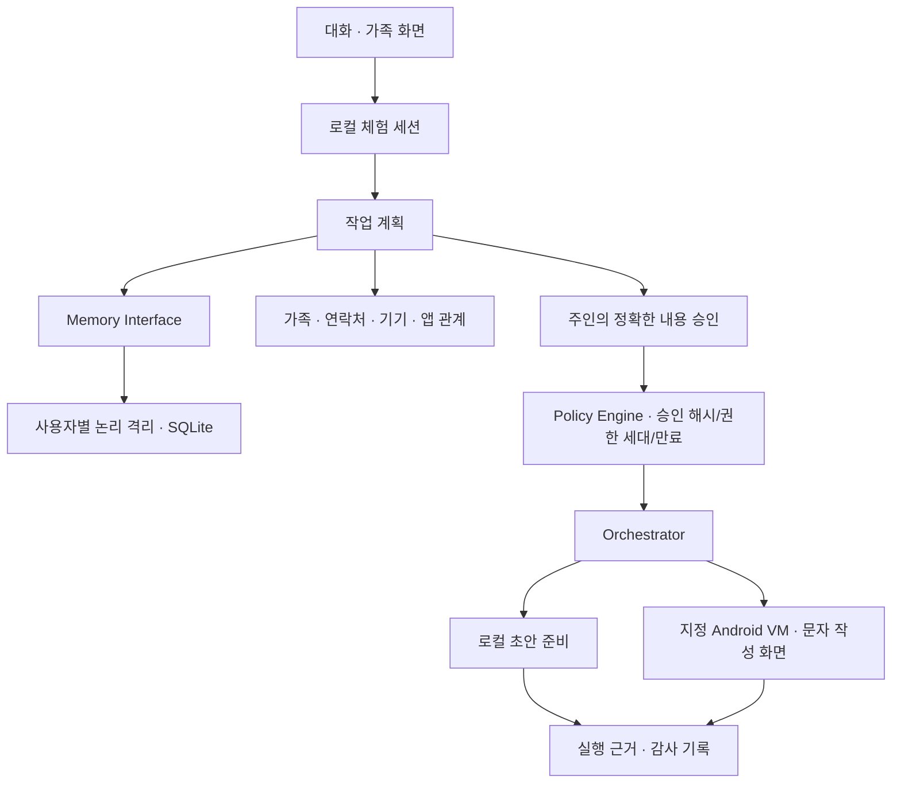

# 개인 에이전트 서버 구조와 실행 안내

> 이전 React 화면과 호환 서버를 개발한 시점의 설계 기록이다. 현재 화면과 서버 실행은 [치즈 실행 안내](../../fa-kakao-demo/README.md) 및 [소유자 API 안내](../apps/api/README.md)를 따른다.

## 당시 동작

기존 React 화면과 Node 24/SQLite 서버를 유지했다. 사용자별 기억, 관계, 동의, 작업 계획·승인·실행·결과를 서버 모듈로 분리했다. 현재 서버의 자연어 분류는 규칙 기반이다. 별도 eve 도우미/LLM이 실행 계획을 제안하더라도 최종 권한 판단은 이 서버가 수행해야 한다.

## 인터페이스

- `server/contracts.d.ts`: MemoryInterface, Family, Contact, Device, Permission, Action, Approval, PhoneExecutor 계약.
- `server/memory.mjs`: 개인 기억의 저장/검색/정정/삭제, 항목·수신자·버전별 공유. 정정 시 기존 공유 해제, 전체 동의 철회 시 공유 해제. source는 서버가 기록한다.
- `server/ontology.mjs`: 기존 데이터를 v2로 변환, 명시적 가족 소속, 소유자별 연락처, 앱 기능 목록과 조회용 그래프. 관계 추론으로 접근 권한을 생성하지 않는다.
- `server/policy.mjs`: 세션 actor, 가족 소속, 주인 동의, 허용 범위, 승인 해시, 정책 버전, 5분 만료, 연락처 변경을 확인한다.
- `server/orchestrator.mjs`: 한 번만 실행하고, 비동기 실행 응답 후 최신 상태를 다시 읽는다. 서버 재시작 시 running 상태를 needs_verification으로 바꿔 재전송하지 않는다.
- `server/phone.mjs`: 고정된 ADB Intent만 실행. 기기 연결 검사 후 권한을 다시 검사한다. 사용자나 모델이 명령어/실행파일/기기 소유자를 지정하지 못한다.

기억은 계획의 참고 데이터다. 기억 속 “아들이 승인해도 된다”는 문자열은 Policy Engine의 권한이 아니다. 공유받은 기억은 명시적 조회로만 제공하며 자신의 기억 검색과 자동으로 합치지 않는다.

## GStack / GBrain / NVIDIA 선택

| 프로젝트 | 이번 적용 | 이유/경계 |
|---|---|---|
| [GStack](https://github.com/garrytan/gstack) | 상위 tooling/gstack에 공식 소스 다운로드, 공식 agents digest를 docs/gstack-workflow.md에 보관 | Codex는 experimental. 전체 CLI/스킬 setup은 미완료: Windows 런타임 설치 명령이 자동 승인 검토에서 차단됨. 전체 설치 성공으로 보고하지 않음 |
| [GBrain](https://github.com/garrytan/gbrain) | 상위 tooling/gbrain에 stable 소스 다운로드, 출처·정정·철회 설계 참고 | 앱 런타임/MCP/클라우드/자동 수집은 활성화하지 않음. 공유 데이터베이스는 사용자 격리로 취급하지 않음 |
| [NVIDIA Auto Ontology](https://github.com/NVIDIA/auto-ontology) | 공식 문서 조사, 전체 설치 보류 | 현재 필요한 가족·기기·작업 관계를 경량 모듈로 구현 |

GStack 기준으로 계획 → 실패하는 회귀 테스트 → 구현 → 권한/경쟁 상태/입력 경계 검토 → 테스트와 빌드 순서를 적용했다. 네이티브 실행 도구가 없어 전체 GStack review/QA 파이프라인을 실행했다고 주장하지 않는다.

### GBrain 교체 시 지켜야 할 조건

1. 사용자별 별도 저장 공간/자격 증명 또는 검증된 원격 권한 경계. source 라벨만으로 격리를 주장하지 않는다.
2. 도구 호출의 actor는 서버 세션에서 결정한다. 모델 생성 owner/source 이름을 그대로 신뢰하지 않는다.
3. 모든 검색 결과를 정책으로 다시 확인하고, 공유는 항목과 버전별로 승인한다.
4. 정정/철회/삭제 시 검색 캐시·벡터·이전 공유를 무효화한다. 오프라인 또는 오류 상황에서는 접근을 거절한다.
5. 클라우드 embedding/synthesis 사용 전에 데이터 전송 설정과 동의를 따로 설계한다.
6. 현재 memory 및 HTTP 격리 테스트를 동일하게 통과한 뒤 어댑터를 활성화한다.

## 실행

호환 API 실행과 검증은 [서버 안내](../README.md)를 따른다.

기본 동작은 실제 로컬 초안 객체 생성이다. 상품 검색, 일정 저장, 메시지 전송은 수행하지 않는다. `prepared`는 전송 완료가 아니다.

### Android VM 연결

운영자가 각 사용자 전용 Android VM을 준비하고 ADB 연결을 설정한다. VM 임대·계정 로그인·전화번호 구매는 자동으로 하지 않는다. `.env.example`의 `MOLLA_PHONE_BINDINGS`에 사용자와 serial을 매핑한다. 실기기/VM 없이 해당 경로를 실제 검증할 수는 없다.

`MOLLA_ALLOW_ANDROID_COMPOSE=1` 설정 후 자신의 연락처를 등록하고 `POST /api/phone/plan`에 `{contactId,draft}`를 보낸다. 승인 전 수신자와 본문을 그대로 보여준다. `POST /api/task/decision`으로 주인이 승인하면 지정 VM의 작성 화면을 연다. ADB 응답은 열기 요청의 근거일 뿐 전송 근거가 아니므로 `needs_verification`으로 남는다. 자동 전송 API는 없다.

Android 작성 동작은 [공식 Common Intents](https://developer.android.com/guide/components/intents-common#Messaging)와 [ADB 문서](https://developer.android.com/tools/adb)에 맞춰 ACTION_SENDTO / smsto / sms_body를 사용한다. 앱별 동작 차이는 연결된 VM에서 추가 검증해야 한다.

## 배포 경계

현재는 loopback에만 열리는 로컬 체험이다. 사용자 전환은 실제 인증이 아니며 브라우저를 사용하는 사람은 체험 사용자로 전환할 수 있다. SQLite 한 파일의 owner 필터는 앱 수준 논리 격리다. 운영 환경에서는 사용자 인증, 가족 초대 검증, 사용자별 암호화/저장소, 기기 보안과 검증된 전송 어댑터가 필요하다. SQLite 상태는 단일 서버 프로세스 사용을 전제로 한다.

기억 삭제는 활성 기억·공유에서 제거한다. 이전에 작성한 대화/별도 백업/SQLite 디스크 잔여 데이터까지 자동 파기한다고 보장하지 않는다. 오래된 백업은 운영자가 관리해야 한다. 실행 중 취소는 이미 열린 기기 화면이나 완료된 외부 동작을 되돌릴 수 없다.

원본 소스 백업: 상위 backups/molla-app-20261109-111648.
